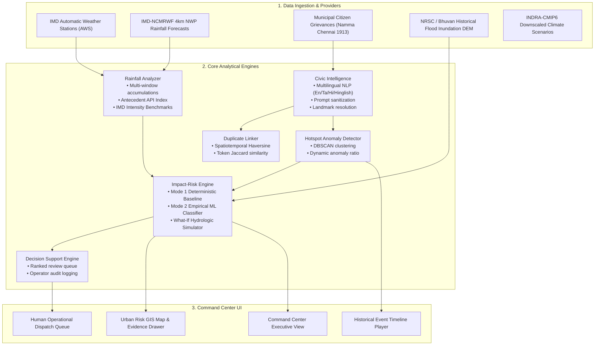

# System Architecture & Analytical Foundations

> **MonsoonWatch India — Rainfall-to-Impact Urban Early Warning System**

---

## 1. System Topology & Data Flow

MonsoonWatch India implements an end-to-end data pipeline translating multi-source meteorological, terrain, infrastructure, and civic observations into explainable decision intelligence.

---

## 2. Mathematical Formulations

### A. Antecedent Precipitation Index (API)
Soil moisture retention diminishes rainfall infiltration capacity over successive days. The antecedent moisture index is computed as:
$$API_t = \sum_{i=1}^N P_i \cdot k^i$$
where $P_i$ is precipitation on day $i$ prior to the assessment time, and $k = 0.85$ represents the empirical daily evapotranspiration and drainage recession coefficient for peninsular Indian catchments.

### B. Mode 1: Deterministic Multi-Factor Hydrologic-Urban Vulnerability Score
The Mode 1 baseline evaluates catchment flood risk ($S \in [0, 100]$) through six transparent, testable physical factors:
$$S = F_{\text{rain}} + F_{\text{api}} + F_{\text{topo}} + F_{\text{imperv}} + F_{\text{drain}} + F_{\text{civic}}$$

1. **Precipitation Hazard ($F_{\text{rain}} \in [0, 30]$):**
   $$F_{\text{rain}} = \min\left(30, \frac{P_{24\text{h}}}{150} \cdot 25 + \min\left(5, \frac{P_{3\text{h}}}{30} \cdot 5\right)\right)$$
2. **Antecedent Soil Saturation ($F_{\text{api}} \in [0, 15]$):**
   $$F_{\text{api}} = \min\left(15, \frac{API}{80} \cdot 15\right)$$
3. **Topographic Low-Lying Vulnerability ($F_{\text{topo}} \in [0, 15]$):**
   Stepwise penalty scaling based on mean elevation above sea level ($h_{\text{msl}}$):
   $$F_{\text{topo}} = \begin{cases} 15.0 & \text{if } h \le 3.5\text{m} \\ 12.0 & \text{if } 3.5\text{m} < h \le 6.0\text{m} \\ 7.5 & \text{if } 6.0\text{m} < h \le 10.0\text{m} \\ 1.5 & \text{if } h > 14.0\text{m} \end{cases}$$
4. **Impervious Surface & Runoff Generation ($F_{\text{imperv}} \in [0, 15]$):**
   $$F_{\text{imperv}} = \min\left(15, \max\left(0, \frac{I - 0.20}{0.80} \cdot 15\right)\right)$$
5. **Drainage Capacity Deficit & Subways ($F_{\text{drain}} \in [0, 15]$):**
   $$F_{\text{drain}} = \min\left(15, \max\left(0, \frac{2.5 - D}{2.5} \cdot 10\right) + N_{\text{subways}} \cdot 2.5\right)$$
6. **Recurrence & Civic Reporting ($F_{\text{civic}} \in [0, 10]$):**
   $$F_{\text{civic}} = V_{\text{hist}} \cdot 6.0 + \min\left(4.0, \frac{C_{\text{active}}}{10} \cdot 4.0\right)$$

Risk is categorized deterministically:
- `CRITICAL`: $S \ge 80$
- `HIGH`: $65 \le S < 80$
- `ELEVATED`: $45 \le S < 65$
- `MODERATE`: $25 \le S < 45$
- `LOW`: $S < 25$

---

### C. Spatiotemporal & Semantic Duplicate Matching Score
Between complaint $c_1$ and $c_2$:
$$\text{CompositeMatchScore} = \left(0.45 \cdot S_{\text{dist}} + 0.25 \cdot S_{\text{time}} + 0.30 \cdot S_{\text{text}}\right) \cdot F_{\text{category}}$$

Where:
- $S_{\text{dist}} = \max\left(0, 1 - \frac{d_{\text{haversine}}(c_1, c_2)}{400\text{m}}\right)$
- $S_{\text{time}} = \max\left(0, 1 - \frac{\Delta t}{480\text{min}}\right)$
- $S_{\text{text}} = \frac{|T(c_1) \cap T(c_2)|}{|T(c_1) \cup T(c_2)|}$ (Token Jaccard coefficient)
- $F_{\text{category}} = 1.0$ if matching issue categories, $0.5$ if distinct.

Candidate pairs with $\text{Score} \ge 0.65$ are recommended for `CONFIRM_MERGE`.

---

### D. Hotspot Cluster Anomaly Ratio
Within spatial cluster radius $R \approx 450\text{m}$, the expected dry-weather complaint baseline is:
$$B = \max\left(0.5, \rho_{\text{baseline}} \cdot \pi \cdot \left(\frac{R}{1000}\right)^2\right)$$
The anomaly ratio is computed as:
$$\text{AnomalyRatio} = \frac{N_{\text{observed}}}{B}$$
Clusters with $\text{Ratio} \ge 3.0$ during concurrent precipitation are classified as `EMERGING`.

---

### E. Operational Decision Queue Priority Formulation
Every suggested action is ranked by transparent operational weight:
$$\text{PriorityScore} = 0.35 \cdot S_{\text{risk}} + 0.30 \cdot S_{\text{asset}} + 0.20 \cdot S_{\text{complaints}} + 0.15 \cdot S_{\text{urgency}}$$

Where critical infrastructure types are weighted by disruption severity:
- `HOSPITAL`: 100 pts
- `SUBWAY / UNDERPASS`: 95 pts
- `PUMPING_STATION`: 90 pts
- `CANAL_OUTFALL`: 85 pts
- `STORM_DRAIN`: 60 pts
